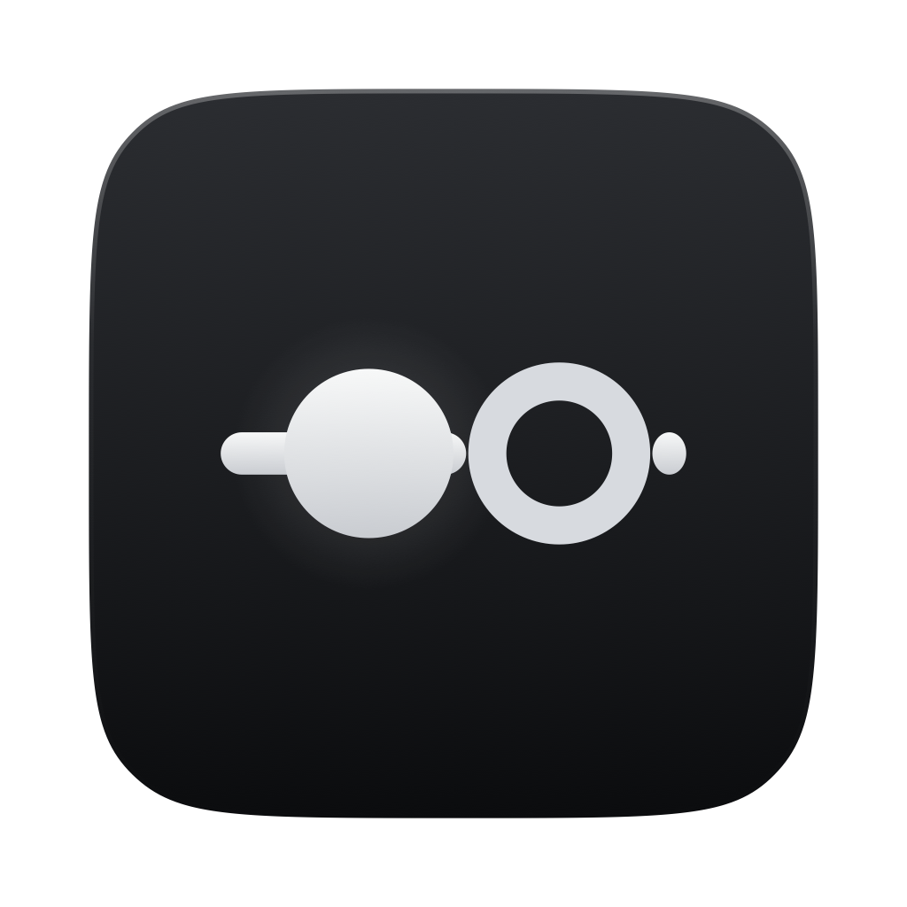
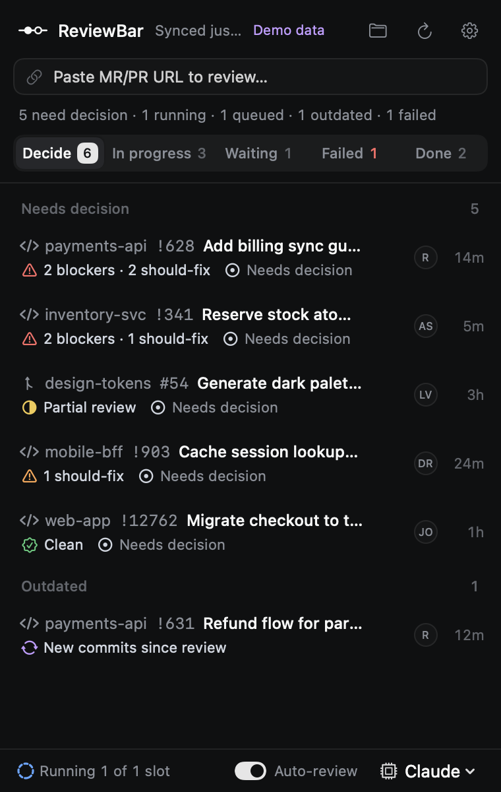
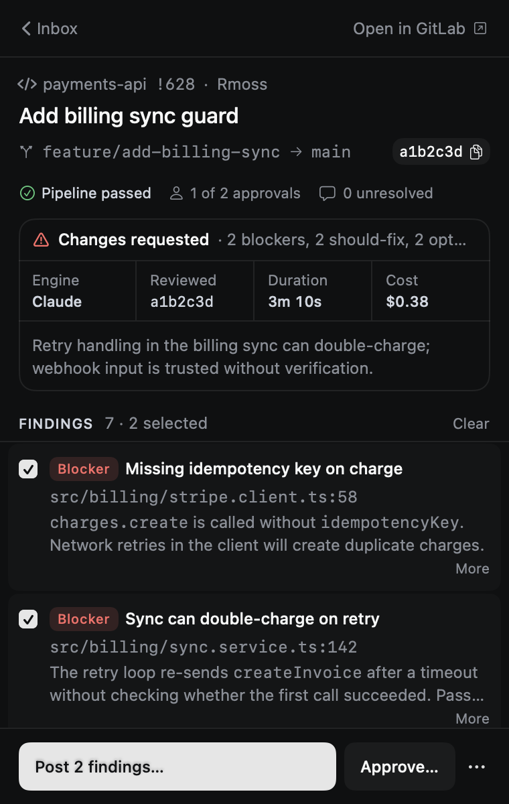
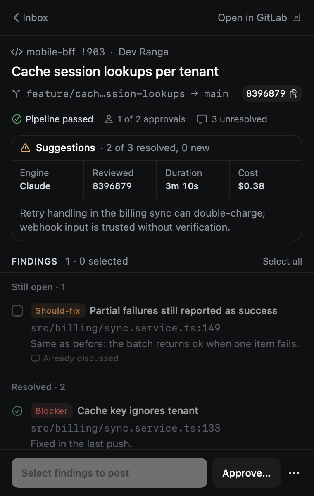

<p align="center"></p>

<h1 align="center">ReviewBar</h1>

<p align="center"><b>AI reviews every MR in the background. You decide what gets posted.</b><br>
A macOS menu bar app for GitLab merge requests and GitHub pull requests, powered by the Claude Code or Codex CLI you already pay for.</p>

<p align="center">
<a href="https://reviewbar.vercel.app">Website</a> · <a href="https://github.com/ganeshmani/reviewbar/releases/latest">Download</a> · <a href="CONTRIBUTING.md">Contributing</a> · <a href="CHANGELOG.md">Changelog</a>
</p>

<p align="center">
<code>brew trust ganeshmani/tap && brew install --cask ganeshmani/tap/reviewbar</code>
</p>

<p align="center">


</p>

## Why

AI code review bots post everything they think of, straight onto the MR. Your teammates read the noise, and you look like you didn't read the code.

ReviewBar keeps a human in the middle:

- **It reviews in the background.** MRs where you're a reviewer are queued and reviewed by `claude` or `codex` while you work. You get a notification when one is ready.
- **You pick what gets posted.** Each finding has a checkbox. Nothing is posted, approved or commented without your click and a confirmation.
- **It re-reviews only what changed.** When the author pushes, ReviewBar reviews the new commits and checks whether each earlier finding was resolved, is still open or regressed.
- **It uses your subscription, not an API key.** It runs your local Claude Code or Codex CLI with your own login, your `~/.claude` config and your installed skills. No extra AI bill, no server, no account.

## Install

```bash
brew trust ganeshmani/tap            # Homebrew asks you to trust third-party taps once
brew install --cask ganeshmani/tap/reviewbar
```

Or download the DMG from [Releases](https://github.com/ganeshmani/reviewbar/releases) and drag ReviewBar to Applications.

**Requirements:** macOS 14 or later (Apple silicon or Intel), and:

- [Claude Code](https://docs.claude.com/en/docs/claude-code) (`claude`) or [Codex](https://github.com/openai/codex) (`codex`), logged in.
- [`glab`](https://gitlab.com/gitlab-org/cli) or [`gh`](https://cli.github.com) logged in, or a personal access token (GitLab `api` scope, GitHub `repo` scope).

> **First launch:** releases are signed but not yet notarized. If macOS says it can't verify the app, open **System Settings → Privacy & Security** and click **Open Anyway**, or run `xattr -dr com.apple.quarantine /Applications/ReviewBar.app`.

## Quick start

1. Click the menu bar icon → **Connect GitLab or GitHub…** It reuses your `glab` / `gh` login, or stores a token in the Keychain.
2. **Settings → Scope:** choose which MRs to watch: review requested, assigned, authored, or specific repos.
3. **Settings → Engine:** pick Claude or Codex and click **Test**.
4. Turn on **Auto-review**, or paste an MR/PR link into the popover to review it now.

Press **⌥⌘R** anywhere to open the inbox. Right-click the icon for Settings and Quit.

Try it without any accounts: `ReviewBar --demo --open` (sample data, no network).

## The review loop



1. An MR is assigned to you. ReviewBar queues it, unless it's a draft or auto-review is off.
2. The engine reviews a SHA-pinned copy of the diff, read-only.
3. You tick the findings worth posting. They land as inline comments on the exact lines.
4. **Copy fix prompt** gives the author a one-line prompt for their own Claude Code session: read the threads, fix or reply, push.
5. The author pushes. ReviewBar re-reviews the new commits and tells you what's resolved.

<br clear="right">

## Safety

- Engines run **read-only** in a per-run workspace (`claude -p --allowedTools Read,Grep,Glob,Skill`, `codex exec --sandbox read-only`).
- Forge tokens and `ANTHROPIC_*` / `OPENAI_*` keys are stripped from the engine's environment, so reviews use your subscription login and can't touch your forge.
- Every post and approval re-checks the MR's head SHA first. If the author pushed in the meantime, nothing is sent.
- Findings only anchor to lines in the reviewed diff. Security findings stay private unless you explicitly allow them.
- Everything stays on your Mac in `~/Library/Application Support/ReviewBar/`.

## Build from source

```bash
git clone https://github.com/ganeshmani/reviewbar && cd reviewbar
scripts/build-app.sh             # → build/ReviewBar.app
scripts/build-app.sh --install   # also copies to ~/Applications and launches it
swift test
```

Diagnostics:

```bash
ReviewBar --selftest-engine claude|codex   # sample review through the real engine
ReviewBar --selftest-forge <MR/PR URL>     # read-only fetch of one MR
ReviewBar --demo --snapshot <dir>          # render every screen to PNG, light and dark
```

## How it works

- **Polling, not webhooks.** It syncs every 5 minutes (configurable), on wake and on refresh. Nothing to host.
- **Two status axes.** A review run status (queued, running, findings, clean, partial, failed, outdated) and a decision status (needs decision, posted, approved, dismissed).
- **SHA-pinned bundles.** GitLab uses the diff version whose head matches the reviewed SHA; GitHub uses `compare/base...head`. A truncated diff is marked Partial, never Clean.
- **Durable state.** SQLite (WAL) holds MRs, runs and an audit log. Runs are saved before they start, so a crash shows "Interrupted, retry" instead of losing work.
- **Idempotent posting.** Each comment carries a hidden `<!-- reviewbar:id -->` marker, used to dedupe and to reconcile uncertain posts before retrying.

## Contributing

Bug reports, ideas and pull requests are welcome. Start with [CONTRIBUTING.md](CONTRIBUTING.md) for setup, project layout and the PR checklist.

- [Report a bug](https://github.com/ganeshmani/reviewbar/issues/new?template=bug_report.yml) · [Request a feature](https://github.com/ganeshmani/reviewbar/issues/new?template=feature_request.yml) · [Ask a question](https://github.com/ganeshmani/reviewbar/discussions)
- Security issues: please report privately, see [SECURITY.md](SECURITY.md).
- Everyone taking part follows the [Code of Conduct](CODE_OF_CONDUCT.md).

## License

[MIT](LICENSE)
